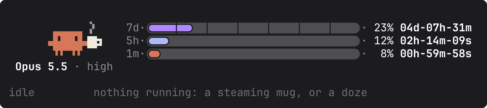

# clawd-band

A Claude Code mod that puts a band above the prompt: an animated pixel-art Clawd that acts out what Claude is doing, your weekly and five-hour usage bars, and a live countdown to each window's reset.



[](https://mods4claude.com/mods/nninkovic95-clawd-band)

**Status:** in active development by one maintainer. This page describes version 0.4.2, tested on Claude Code 2.1.325. The mod API it is built on is early access, so a Claude Code update can break it.

## The band

```
 ┌──── Clawd ───┐  7d ·(████│███░│░░░░│░░░░│░░░░│░░░░│░░░░)· 26% 04d-07h-31m
 │    16 × 3    │  5h ·(█████████████░░░░░░░░░░░░░░░░░░░░░)· 38% 02h-14m-09s
 └──────────────┘  1m ·(████░░░░░░░░░░░░░░░░░░░░░░░░░░░░░░)· 12% 00h-47m-03s
 Opus 5.5 · high
```

- **Clawd**: drawn with kitty's graphics protocol in a box of 16 columns by 3 rows, in stop-motion (a few frames, each held for 400 ms). He is the only thing that moves: the mod replaces Claude Code's own spinner with an empty box. Where the terminal draws no picture, the band draws him in text instead: the same frames in the block characters of Claude Code's own logo, 14 columns by 3 rows, and he moves there too. The text Clawd is the drawing's lower three rows, so what a pose holds above his head shows in the picture only.
- **Model and effort**: the session's model, shortened (`claude-opus-5-5` becomes `Opus 5.5`), then the reasoning effort.
- **Usage bars**: `7d` is the weekly window, cut into its seven days, and `5h` the five-hour window. Each bar keeps its own colour at any level. The one change is on the weekly bar: once the week is in its last three days and you are using it faster than an even share per day, the unused part of those three days turns to the warning colour.
- **Context bar**: the context window, labelled with its size (`1m`, `200k`). The percentage beside it is how full the window is, the same figure as the status line's `used_percentage`; before a session's first reply Claude Code has no such figure, so it is the local estimate that `/context` makes. Beside that, a countdown runs until the prompt cache goes cold: the time since the main thread's last reply, against the cache lifetime (`cache_ttl`). Once it lapses, the countdown turns blue and reads `cold`; the next request re-sends the whole context at the cache-write price.
- **Countdown**: the time to each window's reset, `04d-07h-31m` for the weekly window and `02h-14m-09s` for the five-hour one. Both are 11 characters wide, so they line up under each other. A window nothing is known of shows `--d---h---m` or `--h---m---s`. A window whose reset time has passed shows 0% and `reset` until the next reply opens a new one.
- **A dot either side of each bar** leads the eye from a row's label to its bar and on to its figures.
- **Under the pointer**: point at a row and the band's top row says more about it. For the week and the five hours: how much is used, when the window resets by your clock and, for the week, how long what is left lasts at the pace so far. For the context: its tokens. Nothing is fetched for this; the lines are drawn with the band and shown by the terminal. It needs a terminal that reports the pointer to Claude Code, and has been tried in kitty.

With the default `pill` style each bar is a picture too: a rounded bar whose unfilled part lets the terminal show through, the fill inside a thin clear ring, and thin clear lines between the week's days. Where the terminal draws no picture, the bars are drawn in text.

In a narrow window the band gives way in this order: the countdowns lose their smallest unit, then go; Clawd turns to text, then hides. A bar is never shorter than 4 cells.

## Why use it

Claude Code's status line is one line of text that a script of yours prints. clawd-band needs no script: it shows the three figures that decide how you work (the week, the five hours, the context window) with live countdowns, shares each reading between all your sessions on the machine without a network call, and tells you at a glance what Claude is doing right now.

It does not track cost or keep a history, and the band is drawn in the terminal only: in the desktop app and the IDE extensions there is no band. If you want cost per session or usage over time, a status-line script or a usage tool is the better fit.

## Requirements

- **Claude Code with mods** (function-hook plugins): tested on 2.1.325. Older builds are untested.
- **Any terminal** for the band itself. Pictures (Clawd, and the bars in the `pill` style) need the kitty graphics protocol and have been tested in [kitty](https://sw.kovidgoyal.net/kitty/). Elsewhere Clawd and the bars are drawn in text.
- **A [Nerd Font](https://www.nerdfonts.com/)** for bars drawn in text in the `blocks` style, which is also what `pill` falls back to: their rounded ends are the font's half-circle glyphs.
- **Your terminal's cell shape**, for pictures to keep their proportions: set `cell_ratio` to how many times taller than wide one character cell is. The default `2.2` suits most fonts.
- **For pictures in background sessions:** the environment variable `CLAUDE_CODE_FORCE_TERMINAL_IMAGES=1` for Claude Code (tested in the `env` block of managed settings). Claude Code turns pictures off in background sessions, and without the variable the band is text there. Set it only if every terminal you open sessions from draws kitty graphics.
- **A claude.ai subscription login** (Pro or Max) for the usage bars: the five-hour and weekly windows belong to a subscription, and without one those two bars read `--`. The context bar works with any login.
- **Nothing to install or build:** the mod has no dependencies.

## Install

At the prompt of a Claude Code terminal session:

```
/plugin install clawd-band --marketplace nninkovic95/clawd-band
```

Answer `y` to add the marketplace, then pick a scope. From a shell instead:

```sh
claude plugin install clawd-band --marketplace nninkovic95/clawd-band
```

To run it from a clone while you work on it: `claude --plugin-dir /path/to/clawd-band`.

## Configuration

Type `/clawd` to open the mod's settings in a panel: a button for each on/off option, a picker for each choice, and a text field for the colours and the cell shape. A change takes effect at once.

The same options are the plugin's `userConfig` fields, Claude Code's standard way for a plugin to take settings, so they are also on the screen shown at install and in `/config`, where each one is a row. Claude Code stores them in `~/.claude/settings.json` under `pluginConfigs`:

```json
{
  "pluginConfigs": {
    "clawd-band@clawd-band": {
      "options": {
        "show_model": false,
        "sprite_color": "#6a9bcc",
        "turn_endings": false,
        "bar_style": "dots",
        "cell_ratio": "2.34",
        "show_weekly": false,
        "bar_color_five_hour": "#4eba65",
        "bar_color_empty": "#80808040"
      }
    }
  }
}
```

| Option | Default | What it does |
| --- | --- | --- |
| `show_model` | `true` | Shows the model and effort line under Clawd. |
| `sprite` | `picture` | How Clawd is drawn. `picture`: a picture where the terminal draws pictures, text elsewhere. `text`: always text. `off`: no Clawd. `random`: picture or text. |
| `sprite_color` | `#d77757` | Clawd's body colour, as hex. The props keep their own colours. |
| `animate` | `true` | Plays each pose's frames. Off, Clawd still changes pose with the session, and each pose holds its first frame. |
| `random_poses` | `true` | Picks one of a pose's animations at random each time. Off, a pose always plays its first. |
| `turn_endings` | `true` | Plays the short ending when a turn ends: finished, interrupted, refused or failed. Off, Clawd goes straight to idle. |
| `bar_style` | `pill` | What the bars are made of: `pill` (pictures), or in text `blocks` or `dots`. See [Bar styles](#bar-styles). |
| `cell_ratio` | `2.2` | How many times taller than wide one character cell of your terminal is, from 1.6 to 2.8. Pictures are drawn for this shape. |
| `show_weekly` | `true` | Shows the weekly bar. |
| `show_five_hour` | `true` | Shows the five-hour bar. With this and the weekly bar off, the account's usage is never asked for. |
| `show_context` | `true` | Shows the context bar and the prompt cache's countdown. |
| `bar_color_weekly` | `autoAccept` | The weekly bar's colour. |
| `bar_color_five_hour` | `suggestion` | The five-hour bar's colour. |
| `bar_color_context` | `claude` | The context bar's colour. |
| `bar_color_warning` | `error` | The weekly bar's last three days when the week is being used up ahead of time. |
| `bar_color_empty` | `inactive` | The unfilled part of each bar. |
| `bar_color_cold` | `blue` | The context bar and its countdown once the prompt cache has gone cold. |
| `cache_ttl` | `1h` | How long the prompt cache lives after a reply: `1h` or `5m`. Claude Code does not tell plugins which one a session gets; subscriptions get an hour, API keys and usage overage five minutes. |
| `keep_spinner` | `false` | Leaves Claude Code's own spinner line in place above the band. Off, Clawd is the only thing that moves. |

A value an option does not take falls back to its default, and a cell shape outside 1.6 to 2.8 is held to the nearer end. With Clawd, the model line and all three bars turned off, the mod draws nothing. The key under `pluginConfigs` is `clawd-band@<marketplace>` for an installed copy, and `clawd-band` (or `clawd-band@inline`) when loaded with `--plugin-dir`.

### Bar styles

`pill` draws each bar as a picture, one row high. Where the terminal draws no picture it falls back to `blocks`. The text styles fill their cells one after another, and a cell passes through every step its style has, so the styles with more steps show finer amounts in the same width.

| Style | Empty to full | Steps a cell shows |
| --- | --- | --- |
| `pill` | a picture | the fill ends on the exact pixel |
| `blocks` | solid, told apart by colour, with rounded ends | 2 |
| `dots` | `⣀ ⣤ ⣶ ⣿` | 4 |

The weekly bar shows its seven days: thin clear lines at exact sevenths in the picture, a blank cell between each two days in text. Picture bars sit in rows directly under each other, level with Clawd; text bars keep a blank row between each two.

### Colours

Each bar colour can be a Claude Code theme key, which follows your `/theme` (`success`, `warning`, `error`, `inactive`, `subtle`, `claude`, `suggestion`, `permission`, `planMode`, `autoAccept`, `ide` and others), a colour name (`green`, `magenta`), or hex (`#4eba65`). A value that is none of these falls back to the default.

Pictures are painted in fixed colours, because Claude Code does not tell a mod what a theme's colours are:

- Hex paints text and picture alike. Eight digits (`#rrggbbaa`) also say how solid the colour is in the picture; the last two are ignored in text.
- A theme key is painted in the picture with its value in Claude Code's dark theme, for these keys: `claude`, `suggestion`, `permission`, `autoAccept`, `inactive`, `error`, `warning`, `success`, and for the name `blue`. Any other key or colour name paints the text as asked and leaves the picture its default colour.
- The unfilled part is two fifths solid in the picture unless its colour is hex.

On a light theme, or for an exact match, set the colours as hex.

## Every pose

The pose follows Claude's current step: waiting for the reply, thinking, replying, or the tool it is calling. When the turn ends, a short ending plays once and Clawd goes back to idle. Most poses have two or three animations; one is picked at random each time the pose is taken up, and with `random_poses` off it is always the first one named below.

### idle

Nothing running. Clawd holds a steaming mug and shuts his eyes over it, or dozes with a "z" drifting up.

### waiting

A turn has begun, or a request has gone out and no word of the reply is back yet. Clawd watches an hourglass run down and tosses it over, or fishes with a float bobbing on the water.

### thinking

The model is thinking. Dots count up in a thought cloud, a bulb beside the head comes on, or two meshed cogs turn on each other, a rivet on each showing which way.

### working

The model is replying, or calls any tool not listed below (`TodoWrite`, an MCP tool, and so on). Clawd hammers hot iron on an anvil, types at a laptop, or tosses a pancake in a chef's hat.

### reading

`Read`, `Grep`, `Glob`, `LS`, `NotebookRead`, `ToolSearch`, and the Claude Docs connector's `read`, `query` and `guide`. Clawd reads down a page with his glasses on, or holds a book open and turns a page.

### writing

`Edit`, `Write`, `MultiEdit`, `NotebookEdit`, and every other Claude Docs tool (`create`, `update`, `batch` and the rest). A pencil writes line after line on a sheet of paper.

### running

`Bash`, `BashOutput`, `KillShell`, `TaskStop`. A stride and a bound with speed lines, or a play button pressed, its bar filling as the command runs.

### searching

`WebFetch`, `WebSearch`. A magnifying glass held up on one side and then the other, a turning globe, or a signal going out arc after arc.

### delegating

`Agent`, `Task`, `SendMessage`, `Workflow`, `Skill`. Clawd hands a note to a small Clawd, who carries it off; a small Clawd pops out from behind him; or a small Clawd types away while he dozes with one eye on it.

### questioning

`AskUserQuestion`. A "?" bobs beside the head, or Clawd lifts an "A" card and a "B" card in turn, while Claude writes the question and while it waits for your answer.

### compacting

The conversation is being compacted, by `/compact` or by itself. Clawd presses a stack of pages flat, or squeezes himself down into an archive box until the lid shuts. The mod learns of a compaction from the text Claude Code puts on its spinner, and reads nothing else of it.

### finished, interrupted, refused, failed

How the turn ended, played once. After an answer: a green tick drawn stroke by stroke, or a chequered flag waved. After Esc: a start and a "!", the thought cloud bursting, or a no-entry sign going up in his way. After a refusal: a shake of the head beside a red cross, or a padlock snapping shut. After an error: a bolt and a reel, or a jolt that leaves him on his back with his legs in the air. With `turn_endings` off, Clawd goes straight to idle.

### How one pose follows another

Claude's steps can change several times a second, faster than a pose can be read. So the band does not cut from pose to pose as the steps come:

- A pose on screen plays four frames (1.6 s) before another takes its place. Of the poses asked for in the meantime, only the latest shows.
- Between two poses Clawd stands for one frame with nothing in hand, as he does in Claude Code's logo: one prop is put away before the next is taken up.
- A turn starts with `waiting`. Between two tool calls, `waiting` takes over only once the wait has lasted two seconds, so the last tool's pose plays on through a short gap. A tool that ended before its pose reached the screen still gets its four frames.
- A turn's ending, a question and idle show at once.
- A pose that comes back within ten seconds goes on with the animation it had.

With `animate` off, the poses still follow the session, each held on its first frame.

### Subagents

A subagent's tool gets a glance: its pose shows once the pose on screen has had its frames, and gives way as soon as the conversation asks for a pose of its own, or after about a second. A subagent's own turns change nothing and play no ending, and a glance never cuts an ending short.

### Pictures and text

Once a second the band asks the terminal whether it draws pictures, by swapping a clear one-cell picture in the band's top row. After three refusals in a row Clawd and the bars are drawn in text; as soon as a swap is taken they are pictures again. So a session that comes back from where pictures could not be drawn gets them back without a reload.

### About the demo

kitty's graphics protocol draws Clawd and the bars as images on their own layer, and terminal recorders such as asciinema record only the text stream, so a recording would show the labels and countdowns alone. The GIF at the top is therefore rendered by [`scripts/render-demo.ts`](scripts/render-demo.ts) from the mod's own frame data (`hooks/sprite.ts`). The script follows the band's layout in `hooks/band.tsx` and uses Claude Code's dark-theme colours. It shows each of the fifteen poses in turn and ends on a cold cache. To re-render it:

```sh
node scripts/render-demo.ts   # needs node 23.6+, rsvg-convert and ImageMagick
```

## Where the numbers come from

The percentages and reset times are the same ones `/usage` shows. The band keeps them current in five ways:

1. **Between your sessions:** every reading is saved with the time it was taken, in the plugin's store, which all your sessions on the machine share. Each session looks at the store once a second and takes a newer reading, so a reply in one session updates the band in all of them, and a new session starts with the newest reading there is. This uses no network.
2. **When a window moves:** Claude Code reads the limits from the response headers of every request and tells the band whenever a window moves by a whole point.
3. **After every turn:** the band reads Claude Code's latest figures again, so a new reset time shows even when the percentage did not move (a window that reset and started over at the same rounded percent).
4. **When there is no live reading:** the band asks your account (see [Endpoints](#endpoints)). That is the case when nothing has been saved yet, when the saved reading was more than five minutes old as the session loaded, and when a window's reset time has passed. A request that fails is tried again after a minute, five times at most; after that the next reply fills the bars.
5. **When a reset time passes:** the window drops to 0% and its countdown reads `reset` straight away, until the next reading names the new window.

Where Claude Code refuses the account request (`CLAUDE_CODE_DISABLE_NONESSENTIAL_TRAFFIC` is set, or the session uses an API key), the first three ways are all there is: the bars follow your replies. Use on claude.ai or another device then shows up after the next reply on this machine.

The context bar's figure is Claude Code's own, read each time the band is drawn. Where Claude Code has no figure yet, before a session's first reply, the band shows the estimate `/context` would make: worked out by Claude Code on your machine, asked for once, and sending no request.

## Endpoints

The mod contacts one host with one request. Everything else it does goes through Claude Code on your machine.

| Request | When | Sends | Gets back |
| --- | --- | --- | --- |
| `GET https://api.anthropic.com/api/oauth/usage` | Only while the band has no live usage reading (way 4 above), and never when both usage bars are off | Your own claude.ai sign-in, attached by Claude Code (the mod never sees the token), and the header `anthropic-beta: oauth-2025-04-20`. No body. | Your five-hour and weekly usage percentages and reset times: what `/usage` shows |

The request is made in `hooks/usage.ts` (`fetchAccountUsage`). [Privacy](#privacy) has the rest: the retries, what ends them, and what is kept.

## Privacy

This section is clawd-band's privacy policy: what the mod reads, stores and sends. clawd-band has no server of its own and collects nothing.

**The one host it contacts is `api.anthropic.com`, with the one request under [Endpoints](#endpoints).**

- **When:** only while the band has no live reading: nothing saved yet, a saved reading that was more than five minutes old as the session loaded (also after `/clear` or `/new`), or a window whose reset time has passed (then a few seconds later). One answer settles it. A request that fails is repeated after a minute, at most five times in all; a 429 ends the tries at once. Otherwise the readings Claude Code takes from the response headers of its own requests are used and nothing is fetched. With `show_weekly` and `show_five_hour` both off, the request is never made. Where `CLAUDE_CODE_DISABLE_NONESSENTIAL_TRAFFIC` is set, Claude Code refuses this request and nothing leaves the machine.
- **What is sent:** the request carries your own claude.ai sign-in, which Claude Code attaches through `$.session.authorize()` (the mod never sees the token), and the header `anthropic-beta: oauth-2025-04-20`. It has no body. Nothing from the conversation, your files or your settings is sent.
- **What comes back:** your five-hour and weekly usage percentages and reset times. This is the same data `/usage` shows. An API-key session makes no request.

**What it reads from the session** (all of it stays on your machine):

- The name of each tool Claude calls (for example `Read` or `Bash`), to pick the pose. It does not read tool inputs, tool results or message text.
- Whether the model's output stream is in a thinking, text or tool-call part, to switch between the thinking and working poses. It does not read the content of those parts.
- How a turn ended (answer, interrupted, refused, error), to pick the ending, and whether an event is a subagent's.
- The message on Claude Code's spinner, only to see whether it says a compaction is running.
- The model name and reasoning effort, for the line under Clawd.
- The rate-limit readings Claude Code already holds, and how full the context window is. For a session Claude Code has no figure for yet, it asks Claude Code for its local estimate of the context's size, a number of tokens. None of it is stored, logged or sent.
- The session id, to notice a `/clear` (which starts a new session in the same process) and load the band again. It is never sent.
- Claude Code's list of settings rows, when the `/clawd` panel is drawn. It uses only this mod's own rows, and changes one only when you press, pick or type in that panel.

**What it stores,** in Claude Code's own plugin store on your machine:

- The last usage reading with the time it was taken, and the last model and effort. Your sessions on the machine share that store, which is how one session's reading reaches the others and how the band is filled at startup. A cached effort is shown only for the same model. Each new reading replaces the old one.
- One diagnostic note, written only when a usage bar is still empty five seconds into a session: the time, the session id, which window is missing, which windows the store held, which windows Claude Code reported, and the one-word outcome of the account request. Each new note replaces the last.

Uninstalling the plugin and deleting its store removes all of it.

**What it logs:** when Claude Code runs with `--debug`, one line in Claude Code's debug log each time the outcome of the account request changes, holding one of `answered`, `no-sign-in`, `api-key`, `http <status>`, `timeout` or `refused or no network`. Never a token, a header or a response.

No telemetry, no analytics, no third parties, no other network calls, and no files written outside the plugin store. The usage request goes to Anthropic under your own account, and Anthropic's [privacy policy](https://www.anthropic.com/legal/privacy) applies to it. Questions or concerns: [open an issue](https://github.com/nninkovic95/clawd-band/issues).

## Hooks

Everything the mod registers with Claude Code. The hooks are in `hooks/register.tsx` and, for the settings panel, `hooks/panel.tsx`. Claude Code hands a hook the whole event; the "reads" column is all the mod looks at.

| Event | Why | Reads | Changes anything? |
| --- | --- | --- | --- |
| `session.start` | Start the band's timer | nothing | no |
| `session.measure` | Take a new usage reading when a window moves | the rate-limit readings | no |
| `turn.start` | Pose: waiting | whether the turn is a subagent's | no |
| `turn.step` | Pose: waiting, then thinking, working or the tool being called; the model line; the cache countdown | the kind of each part of the reply, a tool's name, the model and effort, whether the reply reported usage, whether the step is a subagent's | no; the stream is passed on as it came |
| `tool.call` | Hold the tool's pose while it runs (a subagent's as a glance) | the tool's name, whether the call is a subagent's | no; the call and its result are passed on |
| `turn.complete` | Pose: the ending for how the turn ended; read the usage again | the reason the turn ended, whether the turn is a subagent's | no |
| `command.run` `clawd` | Open the settings panel | nothing | opens the panel; prints nothing in the transcript |
| `ui.render` `Spinner` | Clawd is the only thing that moves; pose: compacting | the surface, whether the spinner's message says a compaction is running | draws an empty box in place of Claude Code's spinner, in the terminal, unless `keep_spinner` is on |
| `ui.render` `PromptHint` | Drop the effort pill, which the model line already shows | the hint line's text | rewrites the hint line without the pill, only when `show_model` is on |
| `ui.render` `AbovePrompt` | Draw the band | the band's width, whether a turn is running, whether a survey holds the band | draws the band, in the terminal; leaves it to a survey |
| `ui.render` `Pane` `clawd-settings` | Draw the settings panel | the list of settings rows, of which it uses this mod's own | draws the panel; a press, a pick or a typed value sets that one setting |

Calls it makes on Claude Code:

| Call | What for |
| --- | --- |
| `$.clock.every`, `$.clock.after`, `$.clock.now` | The one timer that drives the frames and the countdowns |
| `$.state.get`, `$.state.set` | Its own state: the pose, the usage reading, the model, when the cache was last written |
| `$.store.get`, `$.store.set` | The plugin store: the shared usage reading, the model, the diagnostic note |
| `$.session.id`, `$.session.model`, `$.session.usage` | The session's id, model, rate-limit readings and context figure, and the context's estimated size where there is no figure yet (the local `summary` form, which sends no request) |
| `$.session.authorize`, `$.http.fetch` | The one request under [Endpoints](#endpoints) |
| `$.ui.blit` | Swap Clawd's picture for the next frame; ask whether the terminal draws pictures |
| `$.ui.invalidate`, `$.ui.resolve` | Ask for a redraw; get the terminal's elements to draw with |
| `$.ui.log` | The debug-log line described under [Privacy](#privacy) |
| `$.command.register` | Offer `/clawd` |
| `$.ui.open`, `$.ui.toast` | Open the settings panel; say why a setting could not be changed |
| `$.config.list`, `$.config.set` | List the settings rows for the panel (it uses this mod's own); change the one you acted on |

It runs no commands, reads no files and reads no environment variables.

Where the code lives: the band's drawing in `hooks/band.tsx`, the pill bars in `hooks/pill.ts`, the checked options in `hooks/settings.ts`, the usage readings in `hooks/usage.ts`, the context estimate in `hooks/context.ts`, the settings panel in `hooks/panel.tsx`, the sprites in `hooks/sprite.ts` and the rules for which pose shows when in `hooks/pose.ts`.

## Development

```sh
claude plugin validate .
claude plugin test .
```

`claude plugin test` runs eight test files in `hooks/`:

| File | What it covers |
| --- | --- |
| `band.test.tsx` | Pose mapping and the pose through a turn, usage parsing and merging, a reading taken over from another session, the account request and its retries, countdowns, whole frames, the band's layout at every width, the text Clawd, a `/clear` reload |
| `options.test.tsx` | The bar styles and their steps, the choices and a random Clawd, which rows show, Clawd as text or off, the model line, an ended window, a saved value of an option or a style that is gone |
| `picture.test.tsx` | Clawd's picture and its box, the pill bars pixel by pixel, the fall back to text and the way back, a very wide window |
| `usage.test.tsx` | The diagnostic note for a usage bar that stays empty |
| `context.test.tsx` | The estimate for a session Claude Code has no context figure for and when it is asked, the rows' lines under the pointer, the context bar as one fill at every width |
| `panel.test.tsx` | `/clawd`: the command, the panel's controls, what acting on them changes |
| `sprite.test.ts` | The animations read back from their pixels: the cogs turn on each other, the big one clockwise and the small one the other way, and the loop goes right round; waiting has no loading ring |
| `pose.test.ts` | The pose rules with no session around them: the hold, the plain body between two poses, bursts, endings, glances, a compaction |

Saving a file while the mod is loaded through `--plugin-dir` hot-reloads it.

`scripts/` holds four developer tools that the plugin never runs. `render-demo.ts` writes the demo GIF, `docs/demo/tour.gif`; `render-icon.ts` writes `.claude-plugin/icon.png`; `render-preview.ts` writes `docs/preview/poses.html`, a page that plays every pose as the picture and as the text Clawd side by side; `render-transitions.ts` writes `docs/preview/transitions.html`, a page that plays written-down turns through the pose rules beside the same turns cut from pose to pose. All are run by hand with node and only write their one file.

## Credits

The sprites are original to this project. They are drawn in code (`hooks/sprite.ts`) on a 28 × 16 grid, and Clawd's body is Claude Code's own startup logo (`▐▛███▜▌ / ▝▜█████▛▘ / ▘▘ ▝▝`) traced pixel for pixel. Every prop, from the mug and the hourglass to the padlock and the small Clawd, is drawn here.

Clawd is the Claude Code mascot. This is an unofficial community project, not affiliated with or endorsed by Anthropic.

## License

[MIT](LICENSE)

## AI disclosure

clawd-band is built with the assistance of AI: Claude Code, Anthropic's coding agent. A person decides what it does, tries every change on screen and reviews what ships; Claude writes the code, the tests, Clawd's pixel art and this page under that direction. Bugs are the maintainer's to answer for: [open an issue](https://github.com/nninkovic95/clawd-band/issues).
