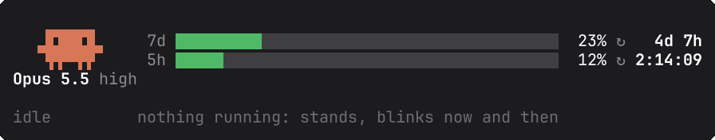
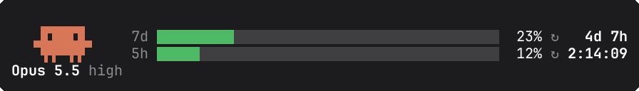
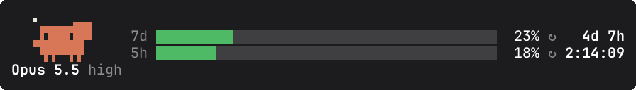
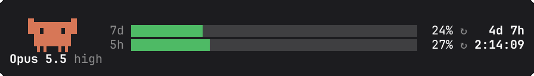
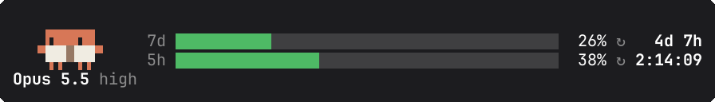
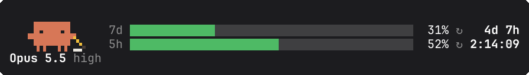
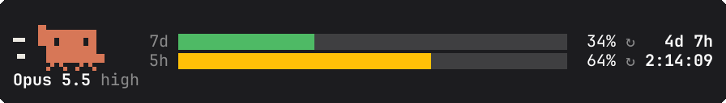
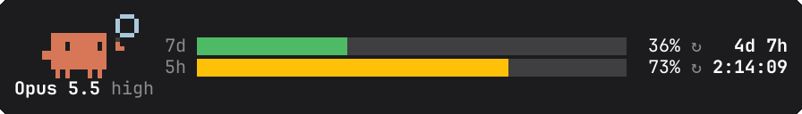
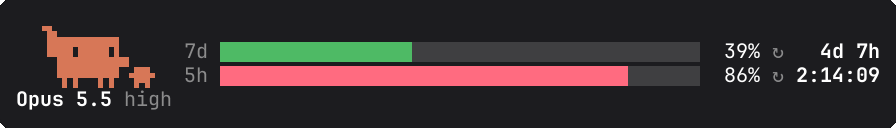
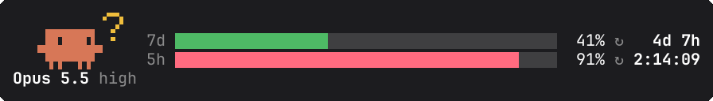

# clawd-band

A Claude Code mod that puts a band above the prompt: an animated pixel-art Clawd that acts out what Claude is doing, your weekly and five-hour usage bars, and a live countdown to each window's reset.



## The band

```
 ┌ sprite ┐  7d ███████████░░░░░░░░░░░░░░░░░░░░░░░░░░░░░  26% ↻   4d 7h
 │ 12 × 3 │  5h ███████████████░░░░░░░░░░░░░░░░░░░░░░░░░░  38% ↻ 2:14:09
 Opus 5.5 high
```

- **Sprite**: Clawd, drawn with kitty's graphics protocol at 12 columns by 3 rows, in stop-motion (a few frames, each held for 400 ms). It is the only thing that moves: the mod replaces Claude Code's own spinner with an empty box.
- **Model and effort**: the session's model, shortened (`claude-opus-5-5` becomes `Opus 5.5`), with the reasoning effort beside it.
- **Usage bars**: `7d` is the weekly window, `5h` the five-hour window. Each bar turns from green to amber at 60% and to red at 85%.
- **Countdown**: the time to each window's reset, `h:mm:ss` under a day, `Nd Nh` beyond. A window whose reset has passed drops to 0% straight away.

## Every pose

The pose follows Claude's current step: thinking, replying, or the tool it is calling. When the turn ends, Clawd goes back to idle.

### idle

Nothing running. Clawd stands and blinks now and then.



### thinking

The model is thinking. A hand scratches the head while a thought bubble rises.



### working

The model is replying, or calls any tool not listed below (`TodoWrite`, an MCP tool, …). Both arms pump.



### reading

`Read`, `Grep`, `Glob`, `LS`, `NotebookRead`, `ToolSearch`, and the Claude Docs connector's `read`, `query` and `guide`. Clawd holds up a book, the eyes run along the line, and a page turns.



### writing

`Edit`, `Write`, `MultiEdit`, `NotebookEdit`, and every other Claude Docs tool (`create`, `update`, `batch`, …). A pencil leaves a line of ink.



### running

`Bash`, `BashOutput`, `KillShell`, `TaskStop`. A stride and a bounce, with speed lines.



### searching

`WebFetch`, `WebSearch`. A magnifying glass, held up on one side and then the other.



### delegating

`Agent`, `Task`, `SendMessage`, `Workflow`, `Skill`. Clawd waves a small Clawd off on its errand.



### questioning

`AskUserQuestion`. A "?" bobs beside the head while Claude writes the question.



While an `AskUserQuestion` menu is open, Claude Code hides the band. The mod also swaps the sprite for Claude Code's text logo and stops animating until the menu closes, so a kitty image can't cover the menu.

### About these demos

kitty's graphics protocol draws the sprite as an image on its own layer, and terminal recorders such as asciinema record only the text stream, so a recording would show the bars with no Clawd. The GIFs above are therefore rendered by [`scripts/render-demo.ts`](scripts/render-demo.ts) from the mod's own frame data (`hooks/sprite.ts`). The script uses the band's layout from `hooks/register.tsx` and Claude Code's dark-theme colours. To re-render them:

```sh
node scripts/render-demo.ts   # needs node 23.6+, rsvg-convert and ImageMagick
```

## Requirements

- Claude Code with function-hook plugins (mods): built against 2.1.296, tested on 2.1.299. The mod API is early access and may change between releases.
- A terminal that supports the kitty graphics protocol, for the sprite. It has been tested in [kitty](https://sw.kovidgoyal.net/kitty/); other terminals are untested.
- A claude.ai subscription login (Pro or Max) for the usage bars: the five-hour and weekly windows belong to a subscription, and without them the bars read `--`.

## Install

At the prompt of a Claude Code terminal session:

```
/plugin install clawd-band --marketplace nninkovic95/clawd-band
```

Answer `y` to add the marketplace, then pick a scope. From a shell instead:

```sh
claude plugin install clawd-band --marketplace nninkovic95/clawd-band
```

To run it from a clone while you work on it: `claude --plugin-dir /path/to/clawd-band`.

## Configuration

The options are the plugin's `userConfig` fields, Claude Code's standard way for a plugin to take settings. You can set them on the screen shown at install, or later in `/config`, where each one is a row. A change reloads the band at once. Claude Code stores them in `~/.claude/settings.json` under `pluginConfigs`:

```json
{
  "pluginConfigs": {
    "clawd-band@clawd-band": {
      "options": {
        "show_model": false,
        "sprite_color": "#6a9bcc",
        "bar_color_low": "suggestion",
        "bar_color_mid": "#ffc107",
        "bar_color_high": "red",
        "bar_color_empty": "subtle"
      }
    }
  }
}
```

| Option | Default | What it does |
| --- | --- | --- |
| `show_model` | `true` | Shows the model and effort line under Clawd. Turned off, the band is three rows tall. |
| `sprite_color` | `#d77757` | Clawd's body colour, as hex. The props keep their own colours. |
| `bar_color_low` | `success` | Bar colour below 60%. |
| `bar_color_mid` | `warning` | Bar colour from 60%. |
| `bar_color_high` | `error` | Bar colour from 85%. |
| `bar_color_empty` | `inactive` | The unfilled part of each bar. |

Each bar colour can be a Claude Code theme key, which follows your `/theme`: `success`, `warning`, `error`, `inactive`, `subtle`, `claude`, `suggestion`, `permission`, `planMode`, `autoAccept`, `ide` and others. It can also be a colour name (`green`, `magenta`) or hex (`#4eba65`). A value that is none of these falls back to the default. The key under `pluginConfigs` is `clawd-band@<marketplace>` for an installed copy, and `clawd-band` (or `clawd-band@inline`) when loaded with `--plugin-dir`.

## Privacy

This section is clawd-band's privacy policy: what the mod reads, stores and sends. clawd-band has no server of its own and collects nothing.

**The one host it contacts is `api.anthropic.com`, with one request:** `GET https://api.anthropic.com/api/oauth/usage` (`hooks/register.tsx`, `fetchAccountUsage`).

- **When:** once at the start of a session, and again after `/clear`, but only if Claude Code has no rate-limit reading yet. Usually a reading already exists, because Claude Code records it from the response headers of its own requests, and then nothing is fetched.
- **What is sent:** the request carries your own claude.ai sign-in, which Claude Code attaches through `$.session.authorize()` (the mod never sees the token), and the header `anthropic-beta: oauth-2025-04-20`. It has no body. Nothing from the conversation, your files or your settings is sent.
- **What comes back:** your five-hour and weekly usage percentages and reset times. This is the same data `/usage` shows. An API-key session makes no request.

**What it reads from the session** (all of it stays on your machine):

- The name of each tool Claude calls (for example `Read` or `Bash`), to pick the pose. It does not read tool inputs, tool results or message text.
- Whether the model's output stream is in a thinking, text or tool-call part, to switch between the thinking and working poses. It does not read the content of those parts.
- The model name and reasoning effort, for the line under the sprite.
- The rate-limit readings Claude Code already holds.
- The session id, to notice a `/clear` (which starts a new session in the same process) and load the band again. It is compared with the last id seen and never sent.

**What it stores:** the last usage reading and the last model and effort, in Claude Code's own plugin store on your machine, so that the band is filled at startup. A cached effort is shown only for the same model. Each new reading replaces the old one; uninstalling the plugin and deleting its store removes them.

No telemetry, no analytics, no third parties, no other network calls, and no files written outside the plugin store. The usage request goes to Anthropic under your own account, and Anthropic's [privacy policy](https://www.anthropic.com/legal/privacy) applies to it. Questions or concerns: [open an issue](https://github.com/nninkovic95/clawd-band/issues).

## Development

`scripts/` holds two developer tools that the plugin never runs. `render-demo.ts` writes the demo GIFs in `docs/demo/`, and `render-icon.ts` writes `.claude-plugin/icon.png`. Both are run by hand with node, and both write images; neither reads or runs one.

```sh
claude plugin validate .
claude plugin test .
```

`claude plugin test` runs `hooks/band.test.tsx`: pose mapping, usage parsing and merging, countdowns and colours, whole RGBA frames, the band's content, the survey case, a `/clear` reload, and the options (checking, the model line, bar and sprite colours). Saving a file while the mod is loaded through `--plugin-dir` hot-reloads it.

## Credits

The sprites are original to this project. They are drawn in code (`hooks/sprite.ts`) on a 28 × 14 grid, and Clawd's body is Claude Code's own startup logo (`▐▛███▜▌ / ▝▜█████▛▘ / ▘▘ ▝▝`) traced pixel for pixel. Every prop (book, pencil, magnifying glass, thought bubble, "?", mini Clawd) is drawn here.

Clawd is the Claude Code mascot. This is an unofficial community project, not affiliated with or endorsed by Anthropic.

## License

[MIT](LICENSE)
